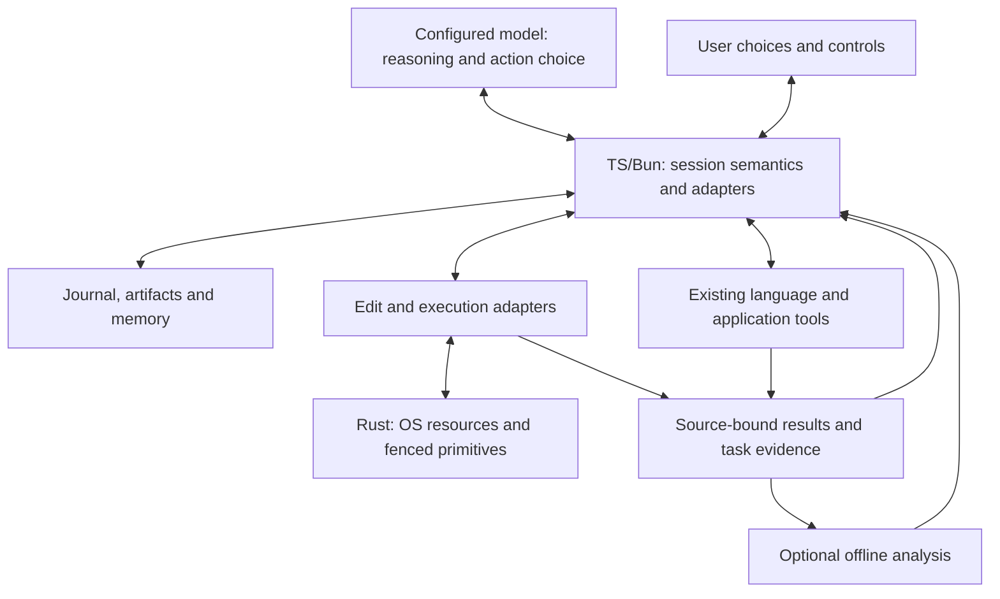

# Openbuff body review and replacement roadmap

Openbuff already has a broad coding body. Its largest improvement opportunity is dependable composition: exact edits, truthful results, owned processes, durable session identity, meaningful recall, and evidence that reaches the next consumer. The model continues to choose its reasoning and actions; the body must give it reliable observations and effects.

Both requested reviews are complete. The **macro catalog** consolidates 144 vertical records into 45 capabilities, distinguishing useful, partial, unwired, absent and unknown behavior. The **micro audit** contains 118 findings from 555 inspected source/test/documentation files and 147,555 reconstructed unique read-window lines, across 13 paired subsystem audits. Every active subsystem and all eight audit domains have a recorded disposition. This is substantial bounded inspection, with explicit assurance limits.

| Read this | It answers |
|---|---|
| [CAPABILITIES.md](CAPABILITIES.md) | What abilities exist, what is missing, their implementation/consumer paths, operation-level language coverage, and what would establish a better version. |
| [AUDIT-REPORT.md](AUDIT-REPORT.md) | Which implementation gaps matter most, why they recur, concrete evidence, reusable strengths, and why older completion predicates were insufficient. |
| [PLAN.md](PLAN.md) | The replacement dependency graph, first executable queue, file ownership, positive/adverse acceptance, verification commands, and stop rules. |
| [SPEC.md](SPEC.md) | The model/body boundary, finite workload and fault envelopes, memory and continuation contracts, and authored-body versus target-language cooperation. |
| [OLD-TASK-MIGRATION.md](OLD-TASK-MIGRATION.md) | All 120 historical declarations mapped once to retain/verify, repair/integrate, split, consolidate, defer or retire. Historical checkboxes are preserved without transferring readiness. |
| [STATUS.md](STATUS.md) | Review decisions, mechanical checks, coverage matrix, source stability and the distinction between completed planning and future implementation. |
| [Detailed findings](findings) | Every cause, source anchor, strength, trigger, consequence, confidence, probe and acceptance proposal. |
| [Evidence guide](evidence/README.md) | Observed test/probe records, captured reproduction sources and their limitations. |

The immediate execution queue is B02/B03/B04: propagate real run termination, confirm mutations only from observed effects, and refuse ambiguous TS ownership while preserving ordinary CAS/snapshot behavior. Independent repairs such as evaluator isolation, provider failures, MCP result fidelity and the current diagnostic false-pass path can then proceed as their own prerequisites permit. This priority is based on effects on user work and the model's next decision.

The next work makes retained knowledge useful across tasks, preserves original run/effect identity through continuation, and integrates actual native execution and a small durable authority. Native adoption includes backend/epoch selection, supported participating writers, migration gates, outage and downgrade behavior. Foreign editor writes and unaware full-access writers retain their explicit conflict boundary. Complete semantic preflight must refuse malformed or unsupported intents before writes; sequential commit and conditional recovery retain truthful intermediate state.

Language choices have explicit responsibilities:

The proposed cooperation boundary below is graded by the plan's separate readiness nodes. Its arrows are planned contracts, not a claim that every integration currently ships.

| Component | Responsibility |
|---|---|
| TypeScript/Bun | CLI, orchestration, policy, configured provider and ecosystem adapters, result and observation semantics. |
| Rust | Capabilities requiring real OS/process/lock/fencing/daemon ownership, consumed through a tested versioned host boundary. |
| Existing ecosystem tools | Parsers, language servers, SCIP indexers, compilers and target-project tools in their existing languages, with operation-specific readiness. |
| Optional offline Python | Statistics, training/export or analysis when a declared workload demonstrates its value; no Python service is required by the authored-body baseline. |

Two separate cooperation proofs replace language counts: an installed TS host→Rust role fixture, and target-project schema/ABI changes followed through real generated interfaces, owning builds/tests and TS/Rust/Python or C/Python consumers. An unknown-language fixture retains useful generic actions and truthful unavailable deeper operations. Conditional frontiers and broader language depth need a declared workload and a new bounded card.

Recorded existing checks include CLI help, 413 passing indexer tests, 28 passing audit/control-plane tests and 19 passing Rust tests. The parser suite had four asset-discovery failures; pinned assets subsequently parsed and compiled queries with explicit paths, so the finding concerns delivery/discovery readiness. Offline diagnostic probes often pass by reproducing current defects. They do not establish repaired behavior, live model gains, full installed readiness or other-platform certification.

No production fixes or goal execution are part of this deliverable. Existing user changes and the historical roadmap are preserved. The plan's acceptance cards remain prospective, with independent review decisions and complete historical/current lineage retained in the accompanying artifacts.
