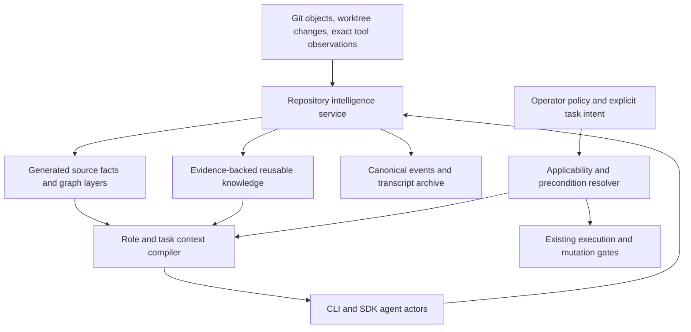

# Repository intelligence and durable knowledge redesign

Implementation follow-up: the approved redesign is implemented and installed. See [IMPLEMENTATION.md](IMPLEMENTATION.md) for final validation, deployment and measured limits. The original audit/recommendation below is retained as historical evidence.

Status: architecture recommendation, not an implemented migration. Product source is unchanged by this review. Findings are based on current source, focused hermetic probes, and read-only local storage measurements. No live two-conversation model evaluation or runtime latency benchmark was performed.

## Recommendation

Overhaul the repository intelligence boundary: give indexing, generated structural facts, reusable knowledge, and context preparation one durable lifecycle and one versioned query interface. Keep their authority and validity semantics distinct. The CLI and SDK should consume prepared, role/task-specific context automatically rather than depending on each model to rediscover how to retrieve it.

For a substantial redesign, a small Rust repository service with SQLite is a good target. Keep agent orchestration and the TUI in TypeScript. Introduce the interface and data model in the existing Bun implementation first; move parsing, graph maintenance, storage, and query hot paths behind the same interface as measurements justify it. This preserves working parsers and SDK virtual-filesystem support while allowing a different backend. A Rust rewrite without those data and consumer changes would retain the present problems.

Language preference is an architectural judgment, not a measured performance result. The strongest confirmed gains concern scope, retrieval admission, persistence granularity, and preservation of derived knowledge.

## What the current implementation establishes

| Priority | Finding                                                                                                                    | Evidence and confidence                                                                                                                                                                                                             |
| -------- | -------------------------------------------------------------------------------------------------------------------------- | ----------------------------------------------------------------------------------------------------------------------------------------------------------------------------------------------------------------------------------- |
| 1        | Declared playbook role/path scope is not applied to prompt delivery or enforcement.                                        | High: scope schema, workspace-wide SQL load, unconditional child copy, and a pure scoped-rule probe agree. See [books](findings/books.md).                                                                                          |
| 2        | Default agent startup lacks an automatic task-specific indexed briefing.                                                   | High: CLI supplies paths; base2/general-agent tests explicitly require removal of automatic proactive retrieval. See [cold start](findings/cold-start.md).                                                                          |
| 3        | Durable memory query reconstructs state from a bounded recent event tail. Old record anchors can disappear from retrieval. | High: query admits newest 10,000 events / 8 MiB before reconstruction; a pinned, verified fact disappeared after 10,001 unrelated events while its projection remained stored. See [records](findings/records.md).                  |
| 4        | Per-agent command-text evidence causes repeated validation and can mistake a mention for proof.                            | High: `echo check:ci-local` satisfies the procedural matcher in a pure probe; this did not bypass terminal authorization or other validation gates. See [books](findings/books.md).                                                 |
| 5        | A saved code index is unavailable until cold reconciliation and publication complete.                                      | High for ordering, unknown frequency in real CLI runs: first query waits only two seconds. See [index](findings/index.md).                                                                                                          |
| 6        | Unchanged metadata refresh removes precise SCIP enrichment.                                                                | High: actual merge/update probe produced one precise edge before refresh and zero afterward with unchanged sources. See [code map](findings/code-map.md).                                                                           |
| 7        | Incremental parse reuse still feeds global graph reconstruction and monolithic index publication.                          | High from current update/persistence paths. See [index](findings/index.md) and [code map](findings/code-map.md).                                                                                                                    |
| 8        | Evidence freshness can depend on the entire workspace revision, reducing reuse after unrelated changes.                    | High: a hermetic probe with unchanged evidence digest and a different workspace revision changed verified=1 to reread-required=1. Actual contribution to past user sessions remains unmeasured. See [records](findings/records.md). |
| 9        | Archive persistence duplicates message bodies in snapshot JSON, message rows, and FTS content.                             | High from schema/writes and local storage accounting. See [records](findings/records.md).                                                                                                                                           |
| 10       | Existing cold-start/ranking tests do not establish reduced rediscovery across two fresh CLI conversations.                 | High for inspected tests. They establish storage/ranking properties; live behavioural savings remain unmeasured. See [cold start](findings/cold-start.md) and [index](findings/index.md).                                           |

Important strengths already present: persisted per-file parse summaries; persisted lexical postings, document frequencies, and adjacency; exact publication ownership/CAS; content-derived index identities; optional precise SCIP integration; typed observations and claims; canonical memory events and maintained projections; live read/edit capability checks. Preserve these. Historical audits describing wholly ephemeral parse caching or per-query graph rebuilding are not accurate descriptions of all current paths.

## Local storage measurements

Read-only snapshot of this Openbuff checkout's storage during the review:

| Measurement                            |    Observed value |
| -------------------------------------- | ----------------: |
| Main memory SQLite file                | 530,518,016 bytes |
| Canonical memory event rows            |            13,883 |
| Discovery rows                         |             6,896 |
| Claim rows                             |             7,071 |
| Evidence rows                          |               465 |
| Archive message rows                   |           252,949 |
| Archive snapshot rows                  |             2,008 |
| Archive message table pages            | 130,396,160 bytes |
| Archive FTS content table pages        | 129,224,704 bytes |
| Archive snapshot table pages           | 117,518,336 bytes |
| Archive FTS data pages                 |  42,737,664 bytes |
| Code index JSON                        |  62,696,881 bytes |
| Indexed files                          |             2,771 |
| Parse summaries and query data present |      Both present |

The memory main-file size excludes any WAL. Counts and sizes are point-in-time observations, not throughput measurements. The code index is near its 64,000,000-byte publication cap, but its parse/query records have not been stripped in the inspected snapshot. Event count exceeds query admission; that supports the relevance of the cap, not a claim that a particular old discovery was lost. The Openbuff checkout's playbook table was empty; scope defects were verified in source and hermetic probes rather than inferred from this table.

## Target architecture

One lifecycle owner and interface can serve several logical stores. Sharing the service does not turn memories into instructions, stale discovery into edit grants, or validation evidence into permission to execute.

### 1. Repository identity and immutable source facts

Persist a repository identity independently from path spellings and remote URL. Give each worktree a separate identity and dirty overlay. Share committed Git blob and content-addressed parse objects across worktrees; keep dirty state, task ownership, and action authority isolated. Support non-Git and SDK virtual filesystems through an explicit source-provider contract.

Store immutable per-file content objects, symbol/chunk summaries, imports, graph edges, and command definitions. Key extraction by content digest, language, parser/grammar version, and extraction configuration. Precise compiler-derived data additionally depends on compiler configuration, dependency state, and producer version.

Generation manifests reference those objects. A one-file change updates its facts, affected import/call relationships, and postings. It does not serialize every parse into a giant JSON document. Known dirty paths must be rehashed even if mtime and size match.

Maintain graph layers by producer: structural/heuristic, compiler-resolved SCIP, and separately typed inferred architectural links. Refreshing the structural layer must preserve unaffected precise layers. Query results expose provenance, freshness, coverage, and unresolved/ambiguous relationships. Auto-generated structure is useful; feature purpose and design decisions require a separate evidence-backed representation.

### 2. Reliable incremental lifecycle

The service owns a sequenced durable change journal fed by exact mutation receipts and watcher notifications. Record watcher overflow and coverage gaps explicitly. Keep an indexed cursor and publish complete immutable generations transactionally.

A new CLI connection immediately opens the last valid generation for discovery and requests a bounded context packet. Reconciliation proceeds in the background. Results identify the indexed generation and any uncertain paths. After offline changes or a watcher gap, this generation is previously valid and currently unverified until its dependencies are attested. Dependent receipts have the same restriction. Fresh source reads still verify affected files before mutation.

While the service stays alive, new conversations reuse its current state. If the service was stopped, or watchers missed changes, background reconciliation is required. An absent journal entry cannot prove that arbitrary offline filesystem writes did not occur. Full attestation remains available for audits and recovery.

### 3. Materialized knowledge search

Keep canonical events for auditability, import/export, and reconstruction. Query maintained projections indexed by repository, entity, selector, claim state, and source dependency. Replay uses checkpoints during repair; replay-tail length never determines whether pinned or still-valid knowledge can be found.

Use SQLite FTS5 for memory text retrieval and durable indexed tables for exact paths, symbols, commands, graph adjacency, and lifecycle predicates. Reuse the existing lexical query logic where useful. Add semantic candidate retrieval when configured; it searches the durable eligible corpus rather than only recently admitted observations. Optional embeddings remain compatible with local/BYOK operation and do not block startup.

A record should include its kind, source-cited payload, dependency fingerprints, repository scope, role/task relevance, provenance/trust origin, lifecycle, confidence, and supersession links. Keep facts, decisions, constraints, recipes, observations, and operator policy distinguishable in the schema.

Validity follows a fact's actual dependencies. A fact about one function stays reusable while the function and its relevant dependencies remain unchanged. A clean-worktree assertion remains tied to current workspace state. A build result may depend on a broad source/configuration/dependency set. This explicitly separates knowledge validity from the current action's workspace authority.

### 4. Complete, scoped procedures and reusable validation

Resolve procedure applicability from authenticated repository/worktree identity, acting role/capabilities, task phase, affected paths, and canonical action effects. The prompt and gate use the same resolved objects. A procedure for the actor spawning a committer belongs to that actor; a commit precondition belongs to the commit action. Agent names alone are insufficient action semantics. Preserve explicit user instructions and applicable root/directory AGENTS policy independently of relevance ranking; global constraints cannot disappear because a role-specific recipe was selected.

Render each selected procedure with its complete condition and prerequisites. Budgeting may omit an inapplicable or lower-priority advisory procedure, or expose a compact reference for later retrieval. It must never retain an imperative while clipping away its conditions. Keep activation state separate from quality/verification state so successful rules remain active.

Use the existing execution-effect classifier for procedural triggers. Remove duplicate shell-text classification. Trusted validation tools issue typed receipts recording repository identity, source/diff dependency fingerprints, recipe/configuration/tool/environment fingerprints, result, and producing actor. Other actors can reuse a receipt when its dependencies still match. Changed inputs invalidate it. When dependency closure is incomplete, bind the receipt conservatively to a broader source/configuration set and revalidate after uncertain changes. A successful echo or a matching substring cannot issue a validation receipt.

Receipts establish evidence, not permission. Current execution approvals and mutation authority remain enforced. This design removes redundant checks and role confusion without adding approval prompts to ordinary authorized delegation. Facts and source-verified recipes can be learned and reused automatically; they gain no new approval requirement. Learned advice remains advisory until an explicit operator policy decision activates it, respecting authorization the user has already supplied; automatic source extraction cannot author binding rules.

### 5. Runtime-prepared context for every actor

Before the first model call, the host prepares a small task packet from durable state. It includes relevant subsystem/feature paths, public interfaces, commands and recipes, useful prior decisions/facts, applicable procedures, validated receipts, and freshness/coverage gaps. Exact path/symbol/command lookup should work without an additional model call; heavier semantic expansion is bounded and optional.

The packet is keyed by task intent, role, relevant source generations, policy version, and query/compiler version. Every spawned child gets its own packet. The editor receives component contracts and editing knowledge; the committer receives the owned change manifest, delivery procedure, and reusable validation/review receipts. Neither depends on inheriting the parent's transcript to recover useful repository knowledge.

Tiny known-file tasks use a minimal packet. Broad/unknown tasks receive a graph-backed feature/subsystem briefing. Fresh-session reuse should be a host behaviour with tests rather than a prompt suggestion that a model might ignore.

Code reads still verify affected source. The product goal is avoiding repeated broad discovery and reasoning while retaining evidence checks where the task requires them.

### 6. Incremental learning and archive storage

After a task, derive candidate discoveries, feature-flow descriptions, reliable command recipes, pitfalls, and explicit decisions from actual tool evidence. Deduplicate by entity/dependencies and semantic relation, link corroboration and contradictions, and preserve source citations. Maintain bounded working sets for prompts; durable knowledge has indexed retention rather than disappearing behind those bounds.

Consolidation operates across tasks on compatible entities and evidence. Updates cannot silently overwrite conflicting claims. Preserve explicit/pinned decisions and referenced evidence; expire or compress low-value raw observations under an inspectable retention policy. A failed or degraded derivation must not replace a valid prior record with an empty result.

Store transcript messages once using stable message identity/content objects. Snapshots retain ordered references and state deltas. FTS uses external content or another single-copy indexing arrangement. Append new message/state records rather than replacing an entire run's archive set. Archive retention, reconstructable raw logs, and curated project knowledge have different lifetimes. Compaction/export/restore must preserve referenced evidence and support rollback.

### 7. Interface and backend strategy

Define a versioned repository-intelligence port with operations such as opening a generation, reconciling source, querying facts, preparing actor context, recording evidence, resolving procedures, and checking validation receipts. Requests carry repository/worktree/actor identity, query scope, cancellation, deadlines, and explicit degraded-result states. Preserve current SDK virtual-filesystem use through an embedded implementation.

| Choice                                                         | Assessment                                                                                                                                                                                                              |
| -------------------------------------------------------------- | ----------------------------------------------------------------------------------------------------------------------------------------------------------------------------------------------------------------------- |
| Bun/TypeScript with the redesigned port and SQLite projections | Fastest route to fix current semantics and establish benchmarks. Existing parsers and tests remain usable.                                                                                                              |
| Rust service behind the same port                              | Preferred long-term candidate for persistent lifecycle, bounded CPU/memory work, incremental graph/search, and isolation from the TUI. This is new work for records, not activation of an existing Rust memory backend. |
| Native Tree-sitter/OXC and existing optional SCIP producers    | Retain and integrate their useful outputs. Compiler precision and parser reuse already have foundations here.                                                                                                           |
| Dedicated search/graph infrastructure                          | Add only when measured corpus/query needs exceed SQLite and the current indexed graph structures. Local deployment and packaging costs must be included.                                                                |

Start with SQLite WAL, indexed projections/graph tables, and FTS5. Store large immutable source/transcript objects outside frequently rewritten rows where appropriate. Semantic vectors can be a separate derived index with source/model fingerprints. A remote vector database is unnecessary for the local-first default.

## Acceptance criteria tied to the user's objective

Measure real elapsed time separately from deterministic correctness tests. Establish baseline numbers before declaring a language or storage speedup. Required behavioural and storage checks:

1. A second fresh conversation on unchanged source retrieves prior useful feature knowledge before its first model response; broad discovery calls and repeated architectural reasoning decrease while task correctness is preserved.
2. Each child receives relevant knowledge independently from transcript inheritance; role/path-inapplicable imperatives never enter its packet or gate.
3. A validation receipt produced by one actor is reusable by another for unchanged inputs; an unrelated file change only invalidates receipts/facts whose dependency scope includes it.
4. Old pinned facts remain retrievable after the event log exceeds 10,000 events and 8 MiB, and after checkpoint/restore.
5. A no-change refresh and a new service process preserve precise SCIP relationships. An affected source/config change invalidates or regenerates only its producer data.
6. A one-file structural change reparses that file and updates affected relationships/postings; canonical graph/index publication avoids full JSON rewriting. Compiler, dependency, or configuration changes can legitimately require broader semantic recomputation. Observe work counts as well as latency.
7. A saved discovery generation is available during reconciliation. Missed watchers, offline edits, symlinks, moves, worktree switches, and non-Git/virtual filesystems produce explicit freshness outcomes.
8. Cache pressure does not silently discard all parse/semantic reuse. Retention and recomputation remain observable and bounded.
9. Archive growth follows new messages and references rather than repeated full snapshots; indexed search, replay, restore, and expiry remain correct.
10. Every retrieved item reports why it was selected, source/dependency validity, relevant audience, and coverage limits. Track useful prior-fact hit rate, wrong-role context, duplicate search/read work, context tokens, first-useful-packet latency, parse counts, graph update counts, and disk growth.

Benchmarks should cover small projects, this checkout, and a large polyglot monorepo, with warm service, cold process, and changed workspace cases. Fix model/provider settings and task difficulty in paired session evaluations. Use network-free programmatic fixtures for deterministic contracts, then bounded real-agent runs for behavioural evidence.

## Migration order

1. Add product-level baseline traces and preservation/applicability tests; correct role filtering, indivisible procedures, precise-layer retention, and shared action classification in the current backend.
2. Replace replay-tail retrieval with transactional indexed projections, add typed validation receipts, and wire per-actor context preparation into CLI and SDK.
3. Split canonical file/parse/graph storage into incremental objects and generation manifests; serve last-valid discovery generations while reconciling.
4. Add cross-task knowledge derivation and incremental archive storage, with evidence-aware retention and repair.
5. Introduce the Rust implementation behind the established port, compare against the Bun baseline, and switch consumers only after parity and workload gates pass.

Preserve old stores, exports, and compatible binaries throughout the reversible migration. Treat existing memory-v1 removal readiness as a separate evidence-gated decision. Importers preserve provenance and explicit user decisions. Derived caches can be rebuilt; canonical records and policy require verified import/export and rollback.

## Evidence limits

This review establishes several concrete correctness/reuse mechanisms and reproduces selected defects. It does not establish their relative contribution to every prior slow or repetitive session. Language speedups, optimal context budgets, semantic recall gains, and real-agent discovery reductions require the proposed baseline/evaluations. No product source was changed and no new executable was installed for this architecture review.
