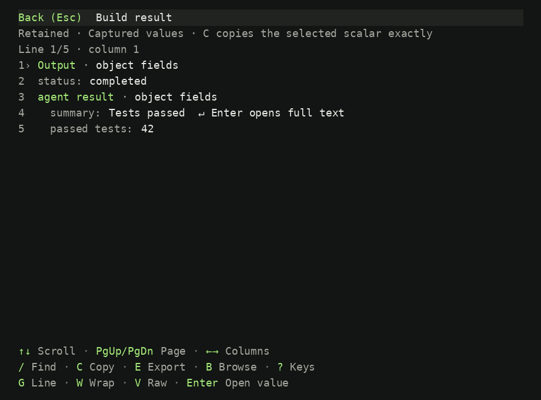
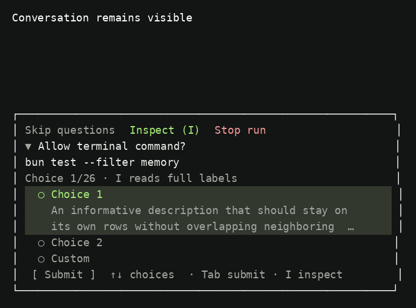
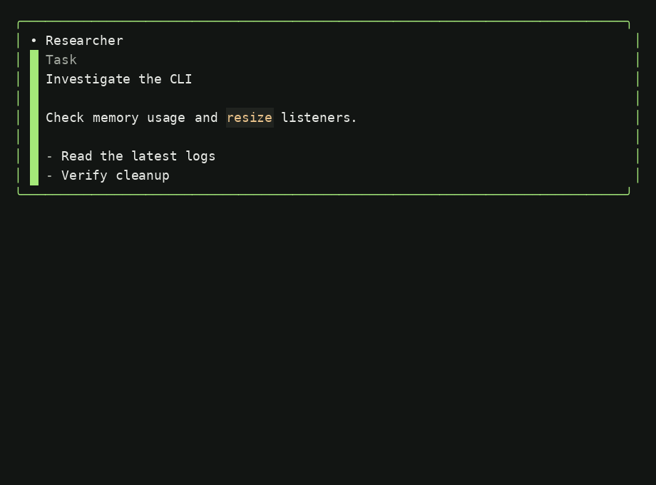

# CLI UI polish — 2026-11-10

The current UI keeps more of Openbuff’s green identity while making captured output and decisions easier to read. The design contract is [DESIGN.md](../../../DESIGN.md), particularly Brand, Components, Responsive behavior and Decisions.

- Dark primary green is `#a4e879`, between the historical `#9EFC62` and the upgrade’s muted `#b0d98a`. Primary headings, task boundaries, active modes and keyboard keys use it. Ordinary prose stays neutral.
- The reader displays indented field labels and distinct heading/value colors. Multiline values have an explicit Enter affordance. `V` switches to original paths; copy/export retain captured data. `/` searches exact captured text; `?` opens the complete keyboard guide.
- Repeated inspect links use quiet inset styling with hover/focus emphasis.
- Agent instructions and Markdown result summaries use the native renderer. Task prose appears immediately while highlighting initializes.
- Mode popups paint above composer boundaries with a clear row between their borders.
- Decision panels fit their contents and are capped at 88 columns. Windowed choices reserve room for focused descriptions and custom input. Command line breaks, explicit truncation and full inspection remain available. Actions have spacing, and Submit uses one row.
- Opening a reader detail resets horizontal offset and wrapping; returning restores the parent. Batched arrow keys retain the latest choice index.

## Validation

- CLI: 4,610 passed, 160 skipped, zero failures.
- Native UI: 165 passed, zero skipped or failed across 39 suites.
- Final compact-dialog adjustment: 27 focused checks passed, including validation ownership, retained answers and keyboard navigation.
- CLI typecheck and compiled OpenTUI/tree-sitter smoke checks passed.
- Installed `openbuff --smoke-opentui` passed. A separate tmux CLI session verified complete Plan-menu borders at 100×24 and a clean resize to the compact 60×18 composer. The temporary session was closed.
- No provider request was needed for UI verification. Earlier memory/listener and responsiveness fixes remain included.

Native fixture frames and color spans: `/tmp/openbuff-ui-polish-frames/`. The PNG previews below render those captured spans with a monospace font on a dark terminal background.

