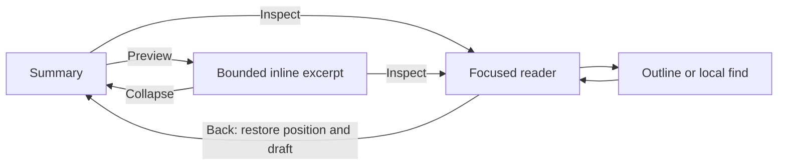

# Proposed CLI interaction sketches

Conceptual terminal wireframes supporting [DESIGN.md](../../../DESIGN.md). Counts, commands, labels and content below are illustrative, not live Openbuff results. These establish information hierarchy and transitions; colors and exact cell geometry require a rendered prototype.

## Conversation: outcomes visible, evidence available

```text
Openbuff  /project                                  Plan · Connected
───────────────────────────────────────────────────────────────────

You
Review the changes and run the tests.

Openbuff
The parser changes are ready. One validation check needs attention.

  ✓ Changes applied    3 files · +42 / −12           [Inspect]
  ▸ Source search      18 matches · 6 files          [Preview]
  ! Tests failed       41 passed · 1 failed           [Inspect]
    parser.test.ts:118 — expected 2 results, received 1

  ▸ Review agents      2 complete · 1 running        [Preview]

───────────────────────────────────────────────────────────────────
› Ask a follow-up…
  Plan    / Commands    @ Files                     Ctrl+P Palette
Reading earlier · 3 new updates                    [Latest] [Stop]
```

An output's identity and outcome remain visible when folded. A failed result exposes an excerpt, not just a red icon. Preview unfolds a bounded excerpt; Inspect opens a separate reading destination. Final answers are readable prose, rather than being automatically reduced to tool cards.

## Reader: an expanded output with landmarks

```text
← Back   Tests › parser.test.ts               Failed · 12,480 lines
───────────────────────────────────────────────────────────────────
Outline                    │ Test output
                           │
  Run summary              │  9788  parser.test.ts
  Suite: lexer             │  9789  ✓ preserves empty tokens
› Suite: parser            │  9790  ! returns grouped matches
    Failure 1              │  9791    expected: 2
  Final counts             │  9792    received: 1
                           │  9793    at parser.test.ts:118
                           │
───────────────────────────────────────────────────────────────────
Find: expected                      Match 2 of 7      [Prev] [Next]
Line 9791 / 12480    Captured output     [Copy] [Export] [Outline]
```

The body has its own viewport. The title, selected scope and return action remain available. Outline entries follow known structure; generic logs use line ranges and find when no reliable section structure exists. An opaque log should not gain invented headings or failure counts.

## Narrow reader: preserve one useful viewport

```text
← Back  Tests · Failed                    [Actions]
───────────────────────────────────────────────────
9788  parser.test.ts
9789  ✓ preserves empty tokens
9790  ! returns grouped matches
9791    expected: 2
9792    received: 1
9793    at parser.test.ts:118

───────────────────────────────────────────────────
Line 9791 / 12480              [Find] [Outline]
```

Outline and find open explicitly, one at a time. On very short terminals, secondary metadata moves into Actions. Returning restores the conversation position, focused block, prompt text and cursor.

## The same reader adapts to different content

| Content | Navigation landmarks | Useful actions |
| --- | --- | --- |
| Markdown answer/plan | Headings, sections, code blocks | Fold section, find, copy section |
| Command log | Logical lines, known sections, captured error locations | Find, next match, go to line, tail/freeze |
| Diff | Files → hunks | Next change, fold context, unified/split |
| Search results | Files → matches | Filter, next match, source location |
| JSON/custom tool | Object/array paths and indices | Expand subtree, find key/value, copy value |
| Table | Rows, columns, headers | Row details, horizontal view, copy row |
| Agent result | Child agents → outputs/artifacts | Inspect one child, next issue |

Render only landmarks supported by retained data. Availability is separate from disclosure:

```text
Showing 50 of 180 captured results           [Inspect all captured]
Only 50 results were captured               [Inspect captured]
Source content unavailable                  [Read receipt]
```

## Navigation sequence



An outline selection or search result lands at a semantic location. Escape first dismisses a local find/outline, then returns from the reader. It must not fall through to the existing run-interruption handler. Global stop remains a separate deliberate action.

## Launch and project selection

```text
Openbuff                                         Choose project
────────────────────────────────────────────────────────────────
Project path or name
› /work/client

Recent projects                                4 available
› client          /work/client                 Updated yesterday
  tools           /work/tools                  Git worktree

Could not open /work/client: directory is unavailable.
[Edit path]  [Retry]  [Choose another]

↑↓ Select    Enter Open    Tab Complete path    Esc Back
```

Loading, no matches and unreadable directory have separate messages. Errors stay inside the picker. Opening a project consumes launch intent once; returning from history cannot resubmit the original prompt. Width/height constrain the list rather than hiding recovery controls.

## Provider and model setup: one pane at narrow widths

```text
← Back   Providers & models                        Unsaved changes
─────────────────────────────────────────────────────────────────
Provider: OpenAI-compatible
Name      local gateway
Endpoint  http://localhost:1234/v1
Key       ••••••••                              [Change]

Connection check                                  Checking…  3 s
✓ Endpoint reachable
… Discovering models                            [Cancel check]

Routes                                             [Choose model]
Default       local-model
Planning      Inherit default

Could not save configuration: project folder is read-only.
Your changes are retained.                        [Retry save]
[Save]  [Discard changes]
```

This is an illustrative BYOK configuration flow. Required setup and optional routes are distinct. List/detail transitions retain selected provider, search and edits. Critical feedback remains visible on short screens. OAuth offers browser and manual recovery using the actual available authorization contract; credentials remain concealed.

## Composer and queued work

```text
You are editing a follow-up                         Draft retained
─────────────────────────────────────────────────────────────────
› Explain the parser change, including Unicode edge cases.
  @ parser.ts   [Inspect attachment] [Remove]

Next in queue                                      2 prompts
1  Review changes        Plan   1 attachment        [Actions]
2  Run tests             Build                     [Actions]

First prompt could not start: provider is unavailable.
[Retry]  [Edit queued prompt]  [Restore to composer]

Agent running · 42 s                                [Stop run]
```

The next FIFO item appears first. Its mode and attachments reflect enqueue time. Actions can expose edit/reorder/cancel when supported; cancellation explains recovery. Retry feedback cannot replace the actual run state. Executing a plan protects an existing draft, and async responses cannot overwrite newer typing.

## Questions and approvals

```text
Question 2 of 3                              Run waiting for you
─────────────────────────────────────────────────────────────────
How should the migration handle old records?

› Preserve and upgrade
  Start a new store
  Write a custom answer

Custom answer
› Preserve records tagged “Skipped”, including comma-bearing IDs.

[Previous question]  [Skip this question]  [Submit answers]
[Back to conversation]                              [Stop run]
```

Long questions/options use a bounded reading viewport and position indicator. User values remain typed data; labels and string joining cannot alter commas or a literal “Skipped.” Back preserves the answer draft and follows explicit execution semantics. Stop is deliberate. Concurrent questions retain request identity.

```text
Review command                                  Approval needed
─────────────────────────────────────────────────────────────────
Command         migration script
Working folder  /work/client
Target          local store

[Inspect complete command]  [Review effects]
Showing 6 of 28 captured command lines

[Allow this action]  [Decline]  [Back]
```

The full approval target must be inspectable before deciding. Summary shortening does not remove access to the command. Show effect/scope only where supported by actual metadata; do not invent a permission classification from command text.

## Activity and changes

```text
← Back   Activity                           1 running · 1 failed
─────────────────────────────────────────────────────────────────
› Parser review       Running · 18 s          [Inspect]
  Test validation     Failed                 [Inspect]
    expected 2 groups; received 1
  File search         Complete · 18 matches   [Inspect]

Queued: 2 prompts                           [View queue]
```

```text
← Back   Changes                           3 files · Partial apply
─────────────────────────────────────────────────────────────────
Files                         │ src/parser.ts
› src/parser.ts    Applied    │ Hunk 2 of 4
  test/parser.ts   Applied    │ - split text by code unit
  docs/parser.md   Not applied│ + preserve Unicode grapheme
                              │
Validation                    │
! Preflight rejected          │ [Previous change] [Next change]
[Inspect reason]              │ [Inspect full diff]
```

Applied files remain applied after a later cancellation. The view relates each hunk to its file and each validation result to its actual outcome. Narrow terminals use Files or Hunk view one at a time, with retained selection and Back. Child-agent results and artifacts use the same inspection route without opening every sibling.

## Session details, health and help

```text
← Back   Session details
─────────────────────────────────────────────────────────────────
Project      /work/client
Active model gateway / parser-model              [View routes]
Run          Retrying · 42 s                      [Stop run]

Memory       Partial · V2 unavailable             [Inspect]
Index        12 diagnostics                       [Inspect]
Updates      Not checked                          [Check guidance]

[Keyboard help]  [Session history]  [Activity]
```

Status reports the actual selected source and known freshness. Notices do not remove lifecycle controls. Diagnostic counts refer to one agreed scope. Help remains open until dismissed and is searchable/readable through the shared bounded view; secondary metrics do not crowd the composer.

## Saved sessions and dashboard

```text
← Back   History                          [New chat] [Find]
─────────────────────────────────────────────────────────────────
› Parser Unicode fix    /work/client      Yesterday · Failed check
  API route cleanup     /work/api         2 days ago · Complete

Selected: Parser Unicode fix
Last answer: one validation check needs attention
[Resume]  [Inspect captured work]  [Delete…]
```

History distinguishes loading, empty, no-match and unavailable. Deletion explains actual recovery availability. New Chat remains a visible keyboard action on narrow layouts.

```text
Runs                      │ Parser Unicode fix
› Parser Unicode fix      │ Captured 2 min ago       [Refresh]
  API route cleanup       │ Showing 2000 captured events [Details]
                          │
                          │ 42  Tests failed         [Inspect]
                          │ 43  Review receipt       [Inspect]
                          │
                          │ Could not refresh. Retained data shown.
                          │ [Retry]
```

This is a conceptual dashboard structure, not a browser mockup. The selected run owns the displayed result. Freshness and retained scope stay visible; structured event/receipt details replace undifferentiated JSON where a known schema exists. Narrow layouts use run-list/detail transitions or explicit horizontal navigation, with native browser keyboard and accessibility semantics.

## Command help, replay and installation output

```text
openbuff — local-first coding workspace

Start       openbuff --cwd /path/to/project
Configure   /setup → provider → model routes
Inspect     /help → outputs, activity, changes, history

Other commands
run         Headless coding run       openbuff run --help
replay      Recorded run inspector    openbuff replay --help
dash        Journal dashboard         openbuff dash --help
serve       Local SDK server          openbuff serve --help
mcp         MCP service/config        openbuff mcp --help
init        Project setup             openbuff init --help
```

Actual help must be generated from supported commands and retain positional-prompt semantics. Replay identifies recorded scope/step range and does not imply a new inference run. Headless text has bounded flush latency; machine events retain their established format.

```text
Updating Openbuff 1.17.4 → 1.17.5
Downloading  24 MB received
Verifying   Release checksum verified
Installing  Could not write the local binary directory
Kept        Openbuff 1.17.4
Next        Check permissions for the displayed install path; retry --update
```

Human install/update phases go to the diagnostic channel; progress uses bounded newline records outside a TTY. Error recovery follows the failed phase, not a universal internet/proxy suggestion. Completion reports what was actually installed or preserved. Plain-text and ASCII fallbacks remain usable through SSH, tmux and redirected logs.
